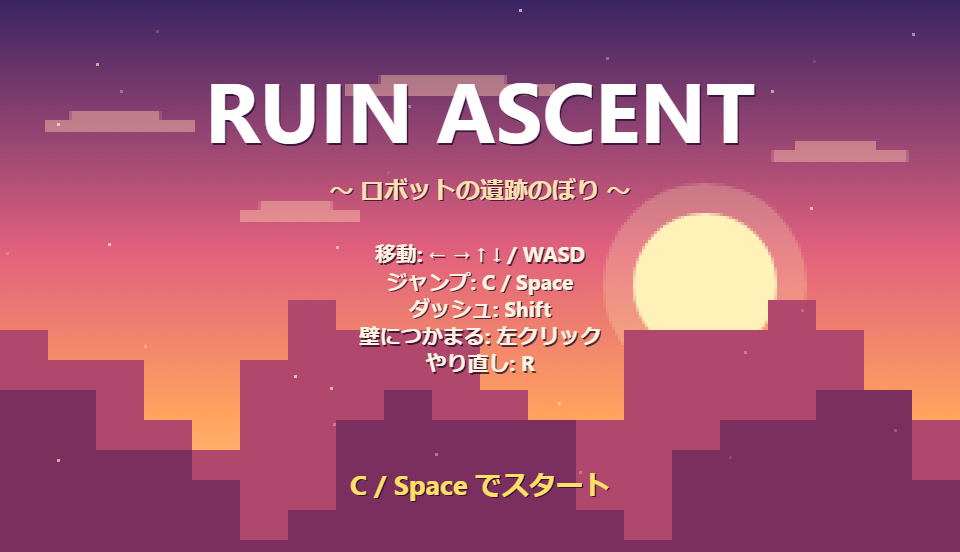
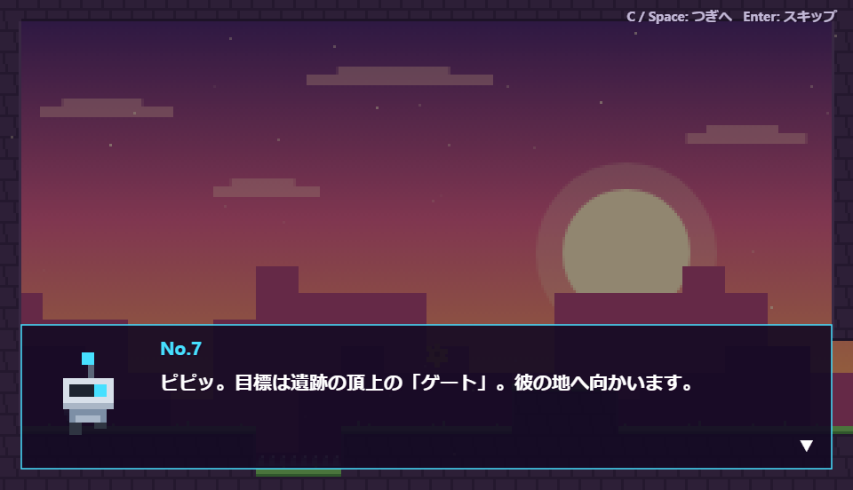
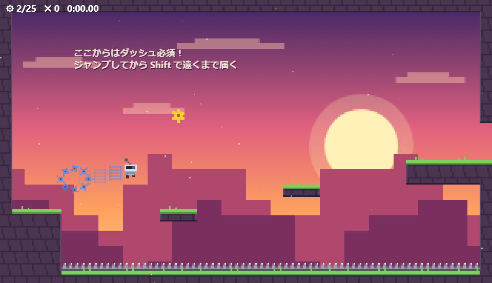
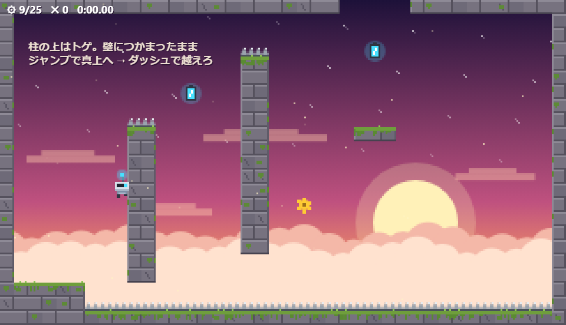
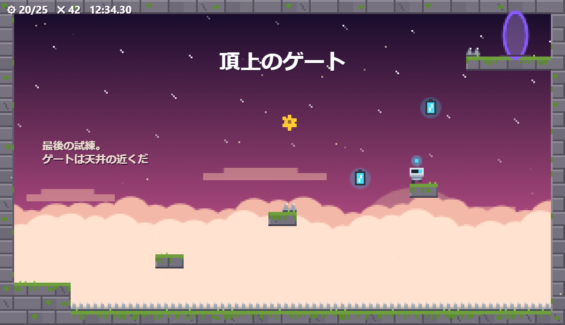

# RUIN ASCENT

小さなロボットが夕焼けの遺跡を登る 2D アクション。ブラウザだけで動きます（ビルド不要）。

**▶ ここで遊べます: https://kdt26aie40004-crypto.github.io/my-game/**



## スクリーンショット

| | |
| --- | --- |
|  |  |
| スタート時のロボットのセリフ | ダッシュで谷を渡る（ステージ4） |
|  |  |
| 苔むした遺跡で壁つかまり（ステージ17） | 雲海の上、最後の試練のゴールの部屋 |

## 遊び方

上のリンクを開くか、手元では `index.html` をブラウザで開くだけ。

| 操作 | キー |
| --- | --- |
| 移動 | ← → ↑ ↓ / WASD |
| ジャンプ（長押しで高く） | C / Space |
| ダッシュ（8方向・空中1回） | Shift |
| 壁につかまる・登る | 左クリック長押し |
| やり直し | R |

- 目とアンテナが水色 = ダッシュ可能、灰色 = 使用済み（着地で回復）
- バッテリーに触れるとダッシュ回復
- 壁ぎわでジャンプすると壁キック
- 地上でダッシュ中にジャンプするとスーパージャンプ（斜め下ダッシュならハイパー）
- チュートリアル3部屋 → ステージ1〜21 → ゴールの部屋（ゲート）の順に進む
  - 1〜3: 上へ登る / 4〜6: ダッシュ必須 / 7〜16: 苔むした石の遺跡エリア（7・9・12 もダッシュ必須） / 17〜20: 高難度 / 21: ぶら下がった壁をダッシュでくぐる
  - 後半は登るほど背景の台地が沈み、足元に雲海、空に星が見えてくる
- スタートするとロボットが目的（頂上のゲートをめざす）をひとこと話す（C / Space で次へ、Enter でスキップ）
- 歯車を集めつつ、最後の部屋のゲートをめざそう（ゴールの部屋は最後の試練として難しめ）

## ファイル構成

```
my-game/
├── index.html        ゲーム画面（canvas）と、下の JS を順番に読み込むだけのページ
├── css/
│   └── style.css     画面中央に表示・ドット絵をぼかさない設定
├── js/
│   ├── config.js     キャンバスの準備、画面サイズ、物理パラメータ、色
│   ├── input.js      キーボード・マウスの入力（キー割り当ては BIND）
│   ├── audio.js      効果音（WebAudio で音を作る）
│   ├── rooms.js      ステージデータ ROOMS（全25部屋）
│   ├── state.js      ゲームの状態（今の部屋・ミス数・タイム・プレイヤー P）
│   ├── map.js        部屋の読み込み、壁やトゲとの当たり判定
│   ├── player.js     プレイヤーの動き（走る・ジャンプ・ダッシュ・壁つかまり）とミス・部屋移動
│   ├── effects.js    パーティクル（歯車・砂ぼこり・火花）、画面の揺れ、漂う光
│   ├── entities.js   歯車・バッテリー・ゴールのゲートの判定
│   ├── story.js      スタート時のロボットのセリフと会話ウィンドウ
│   ├── render.js     描画（背景・タイル・ロボット・アイテム・文字・画面全体）
│   └── main.js       ゲーム開始とメインループ（1/60 秒ごとに更新）
├── images/           README 用のスクリーンショット
└── README.md
```

- JS はビルドなしの普通の `<script>` で、すべて同じグローバル空間を共有しています。
- そのため **`index.html` の読み込み順に意味があります**（例: `story.js` は `config.js` の色を使う、`render.js` は `rooms.js` の `ROOMS` を使う）。新しいファイルを足すときは、使う側を後ろに置いてください。

### どこを触ればいいか

| やりたいこと | 触るファイル |
| --- | --- |
| ステージを増やす・直す | `js/rooms.js` |
| ジャンプの高さ・ダッシュの距離など手触り | `js/config.js`（物理パラメータ） |
| キー割り当てを変える | `js/input.js`（`BIND`） |
| ロボットや背景・足場の見た目 | `js/render.js` |
| スタート時のセリフ | `js/story.js`（`STORY`） |
| エフェクト（歯車の飛び散り方など） | `js/effects.js` |

## ステージの追加

`js/rooms.js` の `ROOMS` 配列に部屋を足すだけ。座標はタイル単位（1部屋 40×23 タイル）。

- `solids`: `[x, y, 幅, 高さ]` の壁・床
- `spikes`: `[x, y, 幅]` のトゲ
- `gears` / `batteries`: `[x, y]`
- 右端か上端に開いている所が次の部屋への出口
